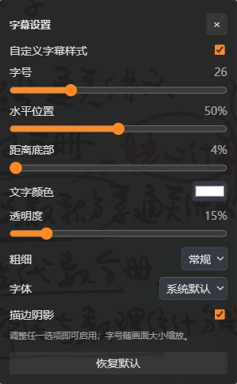

# qihang-player-enhancer / 启航播放器增强

让启航网课的播放操作更顺手：长按临时加速、键盘调音量、一键全屏，以及可以调整位置和外观的字幕。


这是一份安装在 **Tampermonkey（篡改猴，俗称油猴）** 中的浏览器用户脚本。面向在启航教育网页上学习的用户，使用时只需安装一个 `qihang-player.user.js` 文件。普通用户不需要安装 Node.js、不需要运行命令，也不需要部署服务器。

**[安装最新脚本](https://raw.githubusercontent.com/kkkioio/qihang-player-enhancer/main/qihang-player.user.js)** · **[下载发布包](https://github.com/kkkioio/qihang-player-enhancer/releases/latest)** · **[反馈问题](https://github.com/kkkioio/qihang-player-enhancer/issues)** · **[查看更新记录](CHANGELOG.md)**

封面是主要快捷键的示意图；完整操作及新增功能以本文为准。

## 真实课程页运行截图

以下截图于 **2026 年 10 月 28 日**，直接截取自已登录的启航真实课程页面。截图只保留播放器控件区域，未包含浏览器地址栏、账号水印、章节列表或学习记录。

**播放器底部入口。** “字幕设置”与原播放器的倍速按钮并排，位于“正常”倍速按钮左侧：


**展开后的字幕设置。** 字号、位置、颜色、透明度、粗细、字体与描边选项集中在一个面板中。截图中的字号 26、透明度 15% 是拍摄时的示例配置，并非默认值：



这些截图展示了当时课程的界面接入效果；不同课程、播放器版本及浏览器仍可能存在差异。

## 为什么要做这个脚本

看一节网课，真正频繁发生的操作往往很小：老师复述刚刚讲过的内容，想临时加速听过去；讲到重点，又想立刻回到原来的速度。某段录音偏轻，需要把声音调大；字幕挡住板书，想把它挪开一点。每次都移动鼠标、寻找按钮、打开菜单，会不断打断听课的节奏。

这个项目就是围绕这些小操作做的增强。你可以像使用常见视频网站一样按住右方向键加速，松开就恢复；也可以直接用键盘调节音量、静音或全屏。字幕设置则放在播放器底部的倍速按钮旁边，用到时再展开。

原播放器已经提供的空格暂停操作继续保留。脚本主要补充快捷操作和字幕设置，课程的播放权限、购买状态和登录过程仍由启航网站处理。

## 先确认是否适合你的使用场景

本项目主要面向 **桌面版 Chrome / Edge + Tampermonkey + 启航课程网页中的 CC 播放器**。其他浏览器、其他脚本管理器和移动端暂未完成兼容性验证。

脚本匹配 `https://www.iqihang.com/ark/*` 和 `https://iqihang.com/ark/*`，但只在 `record`、`playback`、`playbackBJY` 课程播放路由内启用操作，还需要页面中已经出现可用的视频。字幕设置入口依赖播放器的 CC 倍速控件，因此不能保证启航所有课程、直播类型或未来更换的播放器都能使用全部功能。

你仍然需要登录自己的账号，并进入有权观看的课程。脚本不提供课程解锁、视频下载或账号共享功能。

## 从零开始安装：几分钟让快捷键生效

### 第一步：安装 Tampermonkey

打开 [Tampermonkey 官方网站](https://www.tampermonkey.net/)，选择自己正在使用的浏览器，再按照官网入口进入对应扩展商店安装。安装结束后，可以在浏览器右上角的“扩展程序”菜单里找到它；将图标固定到工具栏，后面管理脚本会更方便。

需要区分两件事：Tampermonkey 是运行用户脚本的扩展，本项目是交给它运行的一份脚本。**本项目没有独立的浏览器扩展安装包，也不需要使用“加载已解压的扩展程序”。**

### 第二步：允许浏览器运行用户脚本

安装扩展后，如果浏览器或 Tampermonkey 提示需要执行权限，请先完成这一步。

在 Chrome 中，在地址栏输入 `chrome://extensions/`，找到 Tampermonkey，进入“详情”。如果页面提供“允许用户脚本 / Allow User Scripts”开关，将它打开。同时检查“网站访问权限”，确保扩展可以在启航课程所在域名运行。

在 Edge 中，可以通过 `edge://extensions/` 进入扩展管理页面，检查 Tampermonkey 的详情、站点访问权限和执行用户脚本相关提示。不同版本的界面可能不同：若没有“允许用户脚本”开关，而 Tampermonkey 要求开启开发者模式，请按扩展的当前提示操作。

Chrome 从 138 起提供每个扩展独立的“允许用户脚本”开关，旧版本及部分环境仍可能使用开发者模式；以浏览器和扩展实际显示的选项为准。可参考 [Chrome 官方说明](https://developer.chrome.com/blog/chrome-userscript) 和 [Tampermonkey 执行权限说明](https://www.tampermonkey.net/faq.php#Q209)。

本脚本在 HTTPS 课程网页运行，不需要为了安装它额外开启“允许访问文件网址”。

### 第三步：安装脚本

**方法一：通过安装链接安装。** 在已经装好 Tampermonkey 的浏览器里，打开 [最新脚本安装链接](https://raw.githubusercontent.com/kkkioio/qihang-player-enhancer/main/qihang-player.user.js)。如果扩展识别到了 `.user.js` 文件，会出现安装页面，确认名称和来源后点击“安装”。

如果链接显示的是一整页 JavaScript 代码，或者网络环境暂时无法访问该地址，可以使用下面的手动方法。

**方法二：手动复制安装。**

1. 从仓库打开 [qihang-player.user.js](qihang-player.user.js)，复制全部代码；也可以在 [Releases 发布页](https://github.com/kkkioio/qihang-player-enhancer/releases/latest) 下载同名文件，用文本编辑器打开后复制。
2. 点击 Tampermonkey 图标，打开“管理面板”，选择“添加新脚本”或工具栏上的 `+`。
3. 删除编辑器里原有的示例代码，将复制的完整脚本粘贴进去。不要复制 README 文字，也不要只复制代码中的某一部分。
4. 按 `Ctrl + S` 保存，回到管理面板，确认这份脚本处于启用状态。

如果下载了整个 ZIP 发布包，解压后真正需要安装的仍然只有 `qihang-player.user.js`。其余文件用于阅读说明或参与开发。

### 第四步：回到课程页试一下

登录启航，打开一节自己可以观看的课程。安装脚本之后，刷新课程页面，让视频加载出来；先点击网页中的空白处，让键盘焦点回到网页。

在视频播放时按住 `→`，稍等约 280 毫秒，应当看到画面顶部出现紧凑的“倍速播放中”提示；松开后恢复之前的速度。在底部控制栏，倍速按钮左侧应当出现“字幕设置”。也可以按 `S` 打开设置面板，按 `Escape` 收起。

如果没有反应，先阅读后面的“常见问题”，不必一开始就重装浏览器。

## 听课时，它具体能帮你做什么

### 遇到熟悉的内容，按住加速，松开回来

长按 `→` 超过约 280 毫秒，视频会进入临时加速，初始默认速度为 **2×**。松开按键，恢复到这次长按之前的速度。例如你原本用 1.5× 听课，临时加速结束后会回到 1.5×。

保持 `→` 按住时，点一下 `↑` 或 `↓`，可以提高或降低临时速度，档位为 **1.5×、2×、2.5×、3×**。选中的临时档位会保存为下一次长按使用的速度，不会把临时速度当作普通播放倍速写进原菜单。

更习惯用鼠标的话，也可以在视频画面表面按住鼠标左键，等到加速开始后再松开；加速过程中同样可以配合上下方向键调档。鼠标长按只在画面表面启动，进度条、按钮和菜单仍用于原来的操作。

短按一次 `→` 则是快进 5 秒；持续按住时，键盘产生的重复事件不会反复跳进度。视频原本暂停时，长按不会主动开始播放。窗口失去焦点、页面被隐藏或切换课程时，脚本会结束临时加速，避免卡在高速状态。

### 想一直用某个速度，就调整普通倍速

`[` 降低普通播放速度，`]` 提高普通播放速度，`R` 恢复 1×。当前普通倍速档位为 **0.8×、1×、1.2×、1.5×、2×、2.5×、3×**。

普通倍速适合整段课程的长期节奏，长按加速适合短暂略过熟悉内容。两者配合使用时，松开长按始终回到那次长按开始前的速度。具体速度是否能成功应用，还取决于浏览器和当前播放器的处理。

### 声音忽大忽小，不必去找音量条

没有长按加速时，`↑` 增加 5% 音量，`↓` 减少 5%，按住可以连续调整，范围是 0–100%。长按加速过程中，上下键优先用于选择临时速度，因此不会一边调倍速一边误改音量。

按 `M` 可以静音，再按一次恢复声音。用 `M` 静音时保留当前视频原来的音量；如果音量已经是 0，再次恢复声音时会使用本次视频记录的可听音量，没有记录则恢复到 80%。调高音量也会解除静音，调到 0 则进入静音。

这里改变的是播放器的音量，不会调整 Windows 或 macOS 的系统音量。

### 全屏、字幕开关，也可以一键完成

按 `F` 进入或退出播放器全屏。`C` 用于开启或关闭可以切换的课程字幕：能使用原 CC 字幕开关时优先复用它，没有对应菜单时尝试独立字幕轨道。字幕语言仍可在播放器原来的菜单中选择。

空格暂停和左方向键继续交给原播放器。本脚本不额外接管它们。键盘焦点在输入框、滑块等表单控件中时，相关按键优先服务于表单；带有 Ctrl、Alt、Shift 或系统键的组合键也会避让。

## 把字幕调成适合自己的样子

点击底部倍速按钮左侧的 **“字幕设置”**，或按 `S`，就能在控制栏上方展开设置面板。展开期间控制栏保持可见，选项较多时可以滚动。再次点击按钮、按 `S`、按 `Escape`、点击关闭按钮或点击面板外即可收起。

默认情况下，课程仍使用原本的字幕显示。**调整任意外观选项会启用自定义字幕样式**，也可以通过面板里的开关手动启用或停用。

| 选项 | 用途与范围 |
| --- | --- |
| 字号 | 12–64 的基准字号，随视频内容区域的大小缩放，不是固定屏幕像素 |
| 水平位置 | 在画面 10–90% 的范围内左右调整 |
| 距离底部 | 在 4–90% 的范围内改变字幕垂直位置，数值越大越靠上 |
| 文字颜色 | 选择自己容易看清的颜色 |
| 透明度 | 0% 不透明，100% 完全透明；调高后字幕变淡 |
| 粗细 | 常规、中等、半粗、粗体、特粗 |
| 字体 | 系统默认、微软雅黑、苹方、思源黑体、宋体、等宽字体 |
| 描边阴影 | 开启或关闭深色描边与阴影，帮助文字在复杂背景上保持可读 |
| 恢复默认 | 撤销自定义显示，恢复原字幕，同时重置外观选项 |

例如，字幕挡住底部公式时，可以增加“距离底部”；白色板书上文字不够清楚时，可以换颜色、调粗或打开描边；想让字幕少遮挡画面时，可以适当提高透明度。透明度只作用于脚本绘制的课程字幕，不会让整个视频或播放器按钮变透明。

设置会保存在当前网站、当前浏览器配置的本地存储里，刷新和切换章节后继续使用。它不会自动跨设备或跨浏览器同步；更换域名、清除站点数据或使用不同浏览器配置，也可能得到另一份设置。

字体使用设备上已有的字体，缺少字体时会回退到其他可用字体，不会额外下载字体文件。全屏后字幕随画面尺寸调整，位置根据视频内容区域计算，尽量避开黑边。

### 为什么有些视频不能改字幕

字幕增强需要课程提供独立的字幕轨道。那种已经压进视频图像里的文字，属于画面的一部分，无法通过字幕开关、改颜色或改透明度单独处理。

启用自定义样式后，脚本读取当前字幕的文字和时间，用自己的显示层呈现；浏览器原字幕绘制会被隐藏，轨道仍继续加载和更新。脚本会避让已识别的 CC 水印轨道。没有可用轨道时，设置先保留，等待字幕加载；如果课程一直没有轨道，就无法应用这些字幕外观设置。

如果看不到字幕，也请检查透明度有没有调到 100%、当前时间段是否有字幕，以及原播放器是否已经关闭了字幕。修改外观并不等于强行开启被关闭的课程字幕。

## 快捷键速查

| 操作 | 效果 |
| --- | --- |
| 长按 `→` 超过约 280 毫秒 | 临时加速，松开恢复 |
| 长按 `→` 时点 `↑` / `↓` | 选择临时速度：1.5×、2×、2.5×、3× |
| 短按 `→` | 快进 5 秒 |
| 鼠标按住视频画面 | 临时加速，松开恢复 |
| 未长按时 `↑` / `↓` | 音量增加 / 减少 5% |
| `[` / `]` | 降低 / 提高普通播放速度 |
| `R` | 普通速度恢复 1× |
| `F` | 全屏 / 退出全屏 |
| `C` | 开启 / 关闭可切换字幕 |
| `M` | 静音 / 恢复声音 |
| `S` | 展开 / 收起字幕设置 |
| 字幕面板打开时 `Escape` | 优先收起面板 |
| 空格、`←` | 沿用原播放器处理 |

## 更新、停用与卸载

通过本项目安装地址安装的版本，元数据提供了更新和下载地址；Tampermonkey 可以按自身设置检查更新，也可以在管理面板中手动检查。更新来源是本仓库的 `main` 分支，不代表每次更新都已经完成真实课程页验收。

如果之前是复制代码手动安装，最稳妥的方式是在 Tampermonkey 中**编辑原来的脚本**，用新版 `qihang-player.user.js` 的完整内容替换并保存，再刷新课程页。不要同时启用旧版和新版两份脚本，否则会发生按键或界面冲突。保留同一浏览器中的站点数据时，新版会继续读取原来的字幕和临时倍速设置。

暂时不想使用时，在 Tampermonkey 中停用脚本，然后刷新课程页；彻底卸载则删除脚本并刷新。已经保存在网站本地存储中的偏好不会因为删除脚本而自动清除。只想还原字幕外观时，在卸载前使用“恢复默认”即可。

## 常见问题：安装后没有反应，先看这里

**已经装了 Tampermonkey，为什么还是不能用？**

确认浏览器的用户脚本执行权限和站点访问权限已开启，管理面板里的脚本也处于启用状态。之后刷新课程页，等待视频加载，再点击网页让焦点离开地址栏。单独安装 Tampermonkey 并不会自动安装本项目。

**找不到“字幕设置”按钮，但其他快捷键有反应。**

按钮需要当前页面出现 CC 播放器的倍速控件。先移动鼠标显示底部控制栏，等待播放器加载完成；若课程使用其他播放器、页面改版或倍速控件不存在，入口可能无法接入。按 `S` 时若提示“播放器倍速控制栏尚未加载”，就说明它还没找到对应控件。

**按键控制到了别的地方，或者同时发生两次操作。**

先收起设置面板并点击网页空白处，退出输入框或滑块的焦点。如果同时安装了其他接管方向键、倍速、全屏的脚本，先停用它们再测试，也检查是否重复启用了两份本脚本。

**有字幕却不能关，或改了大小没有变化。**

先区分它是独立字幕，还是录进视频的文字。只有独立字幕轨道能被处理。课程字幕延迟加载、当前没有字幕句子、课程更换播放器，也可能造成暂时看不到效果。

**全屏后提示、面板或字体位置不正常。**

优先使用播放器自己的全屏按钮或 `F`，确认只有一份脚本在运行。不同课程及播放器版本的全屏结构可能不同；如果仍有问题，请在 Issues 中提供浏览器版本、脚本版本、操作步骤以及问题发生在普通窗口还是全屏。截图请遮挡个人资料和课程敏感信息，不要提交账号、密码、Cookie 或完整的个人课程链接。

**手机、Firefox 或其他视频网站能用吗？**

目前没有完成这些环境的适配验证，也没有为其他视频网站设置匹配规则。本项目的范围是启航网页课程中的上述使用场景。

## 本地运行与隐私

脚本本身不发起网络请求，不上传课程字幕或播放记录，也不读取登录表单、账号密码或验证码。它会访问当前播放器的视频状态、独立字幕轨道和相关控件，并保存两类本地偏好：临时加速档位与字幕配置。

对应的存储键为 `qihang-enhancer:hold-rate:v1` 和 `qihang-enhancer:subtitle:v1`。安装和检查更新时，脚本管理器会访问 GitHub 的下载地址；浏览器扩展自身的行为遵循扩展的权限与设置。

本仓库公开的是增强脚本、文档和自建测试材料，不包含课程视频、购买凭证或第三方播放器源码。本项目为独立的体验增强工具，与启航教育及其播放器服务商没有官方关联。

## 如果你想参与开发

对普通用户来说，安装到油猴的只有一个脚本文件。开发目录里的 Node.js 依赖用于运行测试，不会打包进用户脚本。

```text
qihang-player.user.js       实际安装的用户脚本
README.md                   完整中文介绍与安装教程
使用说明.md                 简明操作说明
CHANGELOG.md                版本更新记录
package.json                开发命令与测试依赖
package-lock.json           固定测试依赖
tests/
  fullscreen-regression.cjs  倍速、全屏、静音与字幕开关回归
  subtitle-volume-regression.cjs
                            音量、字幕样式、透明度及控制栏回归
  fixtures/player-skin.css   自建的最小播放器样式夹具
  preview-server.cjs         使用模拟画面的本地预览
docs/
  assets/keyboard-cover.png  项目封面
  assets/real-player-controls.jpg
                            真实课程的控制栏截图
  assets/real-subtitle-settings.jpg
                            真实课程的字幕设置截图
  TESTING.md                 测试方式与验收边界
.github/workflows/test.yml   自动回归检查
```

使用 Node.js 22 或更新版本，在项目目录运行：

```bash
npm ci --ignore-scripts --no-audit --no-fund
npm test
```

如需检查模拟界面，再运行：

```bash
npm run preview
```

浏览器打开 `http://127.0.0.1:18765/ark/record/preview`。该页面使用自制模拟画面与字幕，不需要启航登录；关闭预览时在终端按 `Ctrl + C`。它直接加载本地脚本，不需要为这个本地地址放宽已安装用户脚本的匹配范围。

脚本开头的 `HOLD_DELAY`、`HOLD_RATES`、`RATE_STEPS` 分别控制长按判定时间、临时倍速档位和普通倍速档位。修改前建议保留备份，修改后重新运行回归检查。

自动测试使用 jsdom 模拟媒体、字幕轨道和全屏状态；**通过这些测试不等于已经通过真实浏览器、真实课程或所有播放器版本的验收**。首次公开整理版的本地检查与限制记录在 [测试说明](docs/TESTING.md)。欢迎通过 Issues 提供可复现的问题，或通过 Pull Request 提交改进。
